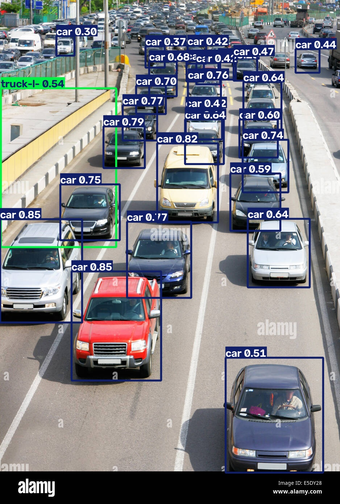
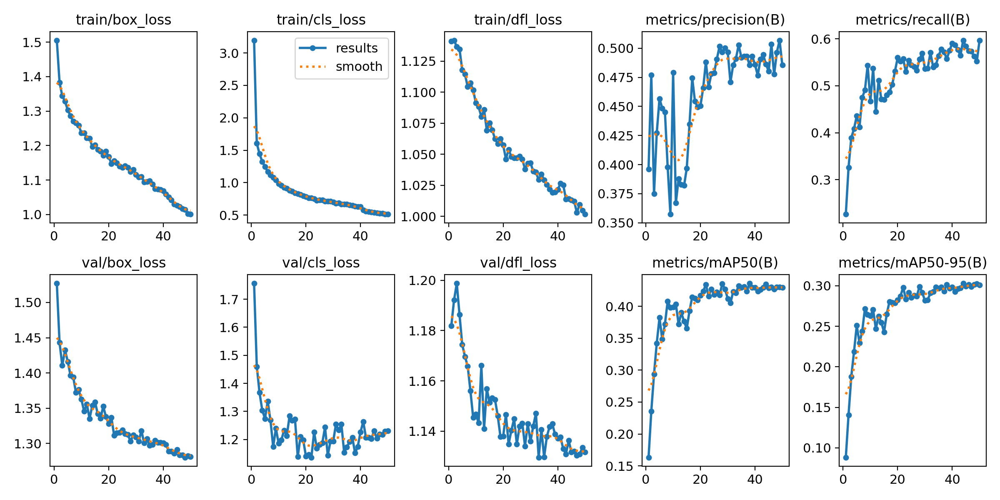
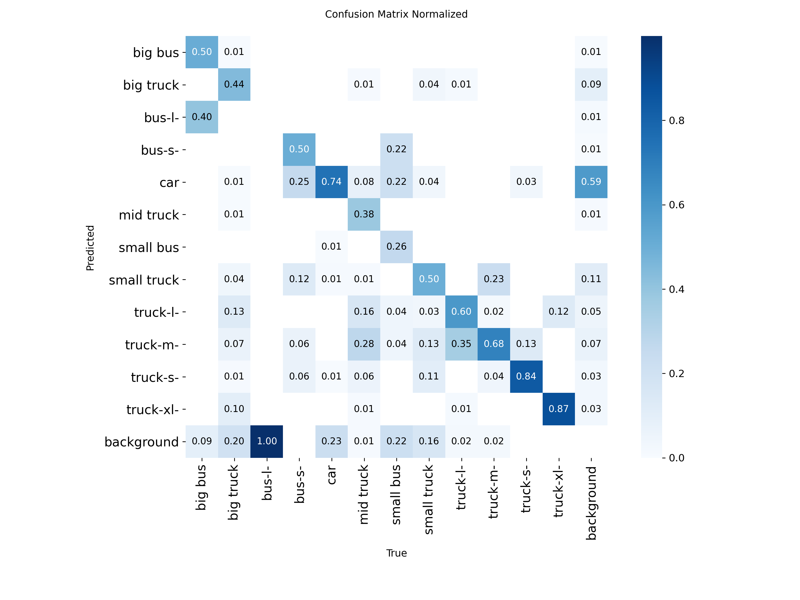

# Vehicle Detection with YOLOv12

Detect, classify and track vehicles in images and video using a **YOLOv12-nano** model fine-tuned on a custom [Roboflow](https://roboflow.com) dataset. The full pipeline (dataset download, training, evaluation, inference and video tracking) is in a single Jupyter notebook.

<p align="center">
  
</p>

## Features

- Fine-tunes COCO-pretrained `yolo12n.pt` on 12 vehicle classes
- Evaluates on a held-out test set (mAP, precision, recall, confusion matrix)
- Runs inference on your own images or videos
- Tracks vehicles across video frames and counts unique vehicles (ByteTrack via Ultralytics)
- Optional ONNX export for deployment

## Dataset

The dataset is hosted on Roboflow (`car-detection-9mxpz-pvcxe`, version 1) and exported in YOLOv12 format.

| Split | Images |
|-------|-------:|
| Train | 2,634 |
| Valid | 966 |
| Test  | 458 |

**Classes (12):** `big bus`, `big truck`, `bus-l-`, `bus-s-`, `car`, `mid truck`, `small bus`, `small truck`, `truck-l-`, `truck-m-`, `truck-s-`, `truck-xl-`

The dataset is not included in this repository. The notebook downloads it to `car-detection-1/` on first run.

## Results

Trained for 50 epochs at 640×640, batch size 8, on an NVIDIA RTX 3050 Laptop GPU (4 GB).

**Test set (458 images, 6,222 objects):**

| Metric    | Score |
|-----------|------:|
| mAP@50    | 0.391 |
| mAP@50-95 | 0.263 |
| Precision | 0.467 |
| Recall    | 0.531 |

**Best-performing classes (test, mAP@50):**

| Class       | mAP@50 |
|-------------|-------:|
| car         | 0.765 |
| big bus     | 0.768 |
| big truck   | 0.557 |
| small truck | 0.514 |

Rare classes such as `bus-l-`, `bus-s-` and `small bus` have very few examples, which lowers the overall mAP. The model reaches about 9 ms inference per image on the GPU.

<p align="center">
  
</p>
<p align="center">
  
</p>

On the sample traffic video, the tracker counted **149 unique vehicles**.

## Project structure

```
Vehicle-detection/
├── vehicle_detection.ipynb     # Full pipeline: data → train → evaluate → infer → track
├── yolo12n.pt                  # COCO-pretrained YOLOv12-nano base weights
├── requirements.txt
├── assets/                     # Sample image and videos for inference
│   ├── cars.jpg
│   └── cars_in_traffic.mp4
└── runs/
    ├── vehicle_yolo12n/        # Training run: curves, confusion matrix, batches
    │   └── weights/best.pt     # Fine-tuned model
    ├── val/                    # Test-set evaluation outputs
    └── predict/                # Annotated inference results
```

## Getting started

### 1. Clone the repository

```bash
git clone https://github.com/<your-username>/Vehicle-detection.git
cd Vehicle-detection
```

### 2. Install dependencies

Install PyTorch with CUDA first. On Windows, plain `pip install torch` installs the CPU-only build.

```bash
pip install torch torchvision --index-url https://download.pytorch.org/whl/cu124
pip install -r requirements.txt
```

### 3. Set your Roboflow API key

```bash
# Linux / macOS
export ROBOFLOW_API_KEY="your_key_here"

# Windows (PowerShell)
$env:ROBOFLOW_API_KEY="your_key_here"
```

If the variable isn't set, the notebook prompts for the key. The key is never saved in the notebook.

### 4. Run the notebook

```bash
jupyter notebook vehicle_detection.ipynb
```

Run the cells in order. To skip training and use the included model, run the last section ("Run on a video"), which loads `runs/vehicle_yolo12n/weights/best.pt` directly.

## Quick inference with the trained model

```python
from ultralytics import YOLO

model = YOLO("runs/vehicle_yolo12n/weights/best.pt")

# Image
model.predict("assets/cars.jpg", conf=0.25, save=True)

# Video with tracking
model.track("assets/cars_in_traffic.mp4", conf=0.25, save=True)
```

Or from the command line:

```bash
yolo predict model=runs/vehicle_yolo12n/weights/best.pt source=assets/cars.jpg conf=0.25
```

## Tips

- **Out of memory on the GPU:** lower `batch` (for example, to 4).
- **Higher accuracy:** swap `yolo12n.pt` for `yolo12s.pt` or `yolo12m.pt` if you have more GPU memory.
- **Windows + Jupyter:** keep `workers=0` to avoid multiprocessing errors.

## Tech stack

- [Ultralytics YOLO](https://github.com/ultralytics/ultralytics) (YOLOv12)
- [PyTorch](https://pytorch.org/)
- [Roboflow](https://roboflow.com/)
- OpenCV, Matplotlib

## Acknowledgements

- YOLOv12 and the Ultralytics framework
- Roboflow for dataset hosting and export
